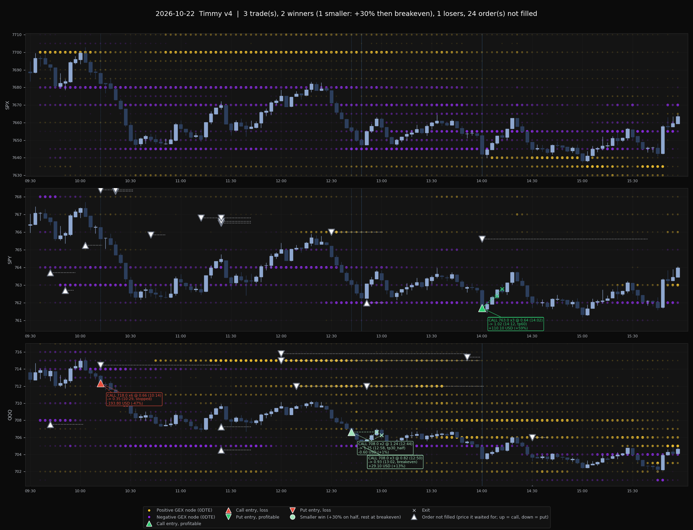

# eod-chart

- Discord username: pckt
- Project identifier: eod-chart
- Kind: agent

## What it does

Draws the end-of-day image my 0DTE agent (Timmy v4) posts to Discord after the close. It shows SPX, SPY and QQQ stacked, each with:

- 3-minute candles for the regular session
- Heatseeker 0DTE GEX nodes as dots per strike per candle. Yellow is positive and purple is negative. Dot size and opacity scale with the node's size relative to that snapshot's King node.
- Every filled trade: an entry triangle (up = call, down = put), a dashed line to the exit `x`, and a label with strike, size, option prices, times, exit reason and P&L. Green means a win, light green a smaller win (+30% on half, rest at breakeven), red a loss.
- Every order that never filled: a hollow triangle at the underlying price it waited for, with a dotted line for as long as it rested.



This is the script exactly as it runs in my setup. Your data will be in other places and other formats. The easiest way to use it is to hand this folder to your own coding agent and ask it to adapt the loaders to your files. The input shapes are listed below so it knows what to produce.

## Files

- `plot_day.py` draws the chart. It is unchanged from my repo.
- `v4_to_chart_inputs.py` is an example converter. It turns Timmy v4's order/fill log (`book_events.jsonl`) into the two trade files `plot_day.py` reads. It's only useful as a reference for writing your own converter.
- `example.png` is the output for 2026-10-22 (simulated book).

## Skylit surface

- Access: REST and the live SSE stream
- Products: Heatseeker (0DTE gamma by strike)

Docs: [REST API](https://docs.skylit.ai/api-reference/introduction) and [MCP server](https://docs.skylit.ai/mcp/overview).

The script does not call Skylit itself. It reads heatmaps you have already saved, in one of the two formats below.

## How to run

Python 3.10+ with `numpy`, `pandas`, `matplotlib` (and `pyarrow` if you use the parquet bar fallback).

```bash
python plot_day.py --day 2026-10-22 \
  --trades eod/trades.json \
  --bars-dir path/with/bars_SYM.json \
  --live-dir path/with/snap_HHMMSS.json \
  --title "My agent" --out eod.png
```

| Flag | Meaning |
| --- | --- |
| `--day` | Trading day, `YYYY-MM-DD` |
| `--trades` | Filled trades file. `events.jsonl` (unfilled orders) is read from the **same folder**. |
| `--bars-dir` | Folder with `bars_SPX.json`, `bars_SPY.json`, `bars_QQQ.json` |
| `--live-dir` | Folder with live heatmap snapshots `snap_HHMMSS.json`. Also used for bars when `--bars-dir` is not given. |
| `--data-dir` | Folder with saved heatmap NPZ files, `<data-dir>/<SPXW|SPY|QQQ>/YYYYMMDD.npz` (checked before `--live-dir`) |
| `--symbols` | Default `SPX,SPY,QQQ` |
| `--no-nodes` | Candles and trades only |
| `--title`, `--out` | Title text and output PNG path |

Default paths (`../data/...`) point at my own repo layout. Pass the flags above, or change `DATA` at the top of the script.

## Input formats

All times are US/Eastern. Panels without node data still draw, and print "no node data" in the corner.

### Bars: `bars_<SYM>.json`

1-minute OHLC, timestamps in UTC (ISO 8601). Either the object below or the same object wrapped as `{"data": {...}}`:

```json
{"time": ["2026-10-22T13:30:00Z", "..."], "open": [...], "high": [...], "low": [...], "close": [...]}
```

Fallback when no JSON file is found: `DATA/ibkr_data/<SYM>_1min.parquet` with columns `ts` (tz-aware), `open`, `high`, `low`, `close`.

### Heatmap nodes, option A: live snapshots `snap_HHMMSS.json`

One file per snapshot, with the ET time in the name. Only `strikes.<strike>.gex0` (0DTE gamma) is used:

```json
{"SPXW": {"spot": 7652.1, "asOf": "...", "strikes": {"7650": {"gex0": -1.2e9}, "7655": {"gex0": 3.4e8}}},
 "SPY":  {...},
 "QQQ":  {...}}
```

The SPX panel reads the `SPXW` key.

### Heatmap nodes, option B: NPZ per symbol per day

`<data-dir>/SPXW/20261022.npz` with `timestamps` (UTC), `strikes` (object array, one strike array per row) and `gex` (object array, one `(n_strikes, n_expirations)` array per row; column 0 = 0DTE).

A node is drawn on a candle only if a snapshot exists within 5 minutes before it, and only if it's above 5% of that snapshot's King node.

### Filled trades: `trades.json`

A list with one row per filled piece. Prices are **option** prices, and `und_entry` is the underlying at the fill, which is where the entry arrow is drawn:

```json
[{"sym": "QQQ", "side": "LONG", "type": "CALL", "strike": 718.0, "qty": 6, "id": "C-QQQ-712.36-L",
  "entry": 0.66, "entry_time": "10:14", "und_entry": 712.36,
  "exit": 0.35, "exit_time": "10:29", "why": "stopped",
  "pnl": -193.8, "pnl_pct": -47.0, "result": "loss", "trade_pnl": -193.8}]
```

- `side`: `LONG` = call, `SHORT` = put
- `result`: `win`, `partial` or `loss`, and colours every piece of one trade the same way. Without it, the colour comes from `pnl > 0`.
- The exit marker's underlying price is read from the 1-minute bars at `exit_time`. When `why` is `tp`, it uses that minute's high (call) or low (put); otherwise the mid of open and close.

A replay format is also accepted: `{"trades": [...]}`, where `entry`/`exit` are underlying prices and `R` replaces `pnl`, with a `log.jsonl` next to it. See `load_trades`/`load_unfilled` in the script.

### Unfilled orders: `events.jsonl`

Put this in the same folder as `trades.json`, one JSON object per line. Orders whose `id` also appears in a `"kind": "fill"` line are skipped:

```json
{"kind": "order", "id": "B-QQQ-720.00-S", "sym": "QQQ", "type": "PUT", "t": "09:43", "ttl_end": "11:25", "plan": {"und_entry": 720.0}}
```

If an order moved, add one line per price it rested at, each with its own `t`/`ttl_end`.

## Environment variables

None. The script reads only local files.
